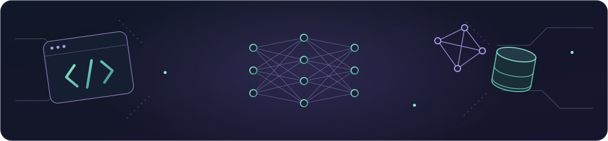
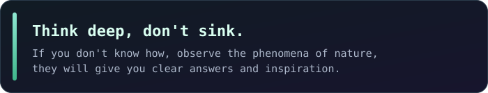

<table>
<tbody>
<tr>
<td valign="middle">

# Hi, I'm Stiv 👋

I like figuring out how things work. These days, that means building AI applications, trying new tools, and checking whether they actually help.

- **Agents and text-to-SQL:** LangGraph, FastAPI, query validation
- **Retrieval:** hybrid search, embeddings, reranking
- **Evaluation:** RAGAS, LLM-as-judge, reproducible benchmarks
- **LLMOps:** vLLM, LiteLLM, Langfuse, Google Cloud
- **MCP security:** token audiences, delegated identity, tenant isolation

</td>
<td align="center" valign="middle" width="420">

</td>
</tr>
<tr>
<td colspan="2" align="center">

</td>
</tr>
</tbody>
</table>

[AI work](#ai-work) · [Projects](#personal-projects) · [Tools](#toolbox) · [Beyond code](#beyond-code) · [LinkedIn](https://www.linkedin.com/in/stiven-velkov/)

## AI work

<strong>Agents, RAG and text-to-SQL</strong>

- Document assistants and text-to-SQL agents built with **LangGraph, FastAPI and React**, including query validation.
- **Hybrid search, embeddings and reranking**, with tenant isolation for document retrieval.
- Fine-tuning of a **compact reranker** for a specific retrieval task.

<strong>Evaluation and benchmarks</strong>

- **RAGAS, LLM-as-judge evaluations and user feedback** to assess application quality.
- Comparisons of **DuckDB and ClickHouse** for analytical workloads.
- Analysis of coding-agent runs, documenting which runs are included and how results are calculated.

<strong>Open models and LLMOps</strong>

- Model selection and serving capacity assessments for the available hardware.
- **vLLM** for serving, **LiteLLM** as a gateway, and **Langfuse** for tracing and feedback.
- Application delivery with **Google Cloud, Docker and CI/CD**.

<strong>MCP and authentication</strong>

- Research on **MCP authorization, token audiences and delegated identity**, starting from the specifications.
- Reference implementations and tests using **OAuth/OIDC, Keycloak, tenant isolation and token exchange**.
- Verification of access boundaries when connecting AI applications to tools.

## Personal projects

| Project | What it does |
| --- | --- |
| **mcp-secure-server** | MCP authentication and tenant isolation, with a runnable Keycloak example |
| **hx** | Run a local coding agent, verify its output, and review changes before applying them |
| **harness-lab** | Analyze recorded agent runs and generate reproducible reports |

<strong>A note on experiments</strong>

I document the task, data, model and measurement conditions behind a result. For coding-agent comparisons, I also record which runs were excluded and why.

## Toolbox

| Area | Tools and topics |
| --- | --- |
| **Languages** |     |
| **Applications** |      |
| **AI and RAG** |         |
| **Evaluation and LLMOps** |      |
| **Databases and retrieval** |        |
| **Cloud and delivery** |         |
| **Authentication** |    |

## Beyond code

I'm a **national karate champion**, a **1st-dan black belt**, and an instructor. I've won numerous competitions and coached students who won at national level. I enjoy teaching younger students and helping them develop discipline.

<strong>A bit more about me</strong>

My curiosity started with the family desktop: setting up our home Wi-Fi, figuring out how things worked, and looking for free alternatives to the tools I used.

I care about healthy living. I'd like to travel the world, learn about different cultures, and work on my own projects along the way.

I believe knowledge should be accessible to everyone. That's one reason I want to share what I learn. I hope AI can give us more time to live, learn and understand ourselves.

[LinkedIn](https://www.linkedin.com/in/stiven-velkov/) · [GitHub](https://github.com/SkT97)

